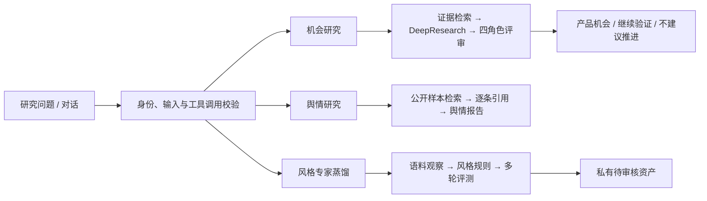

# OppScout

**面向情报研究的 Agent 平台 · Intelligence Research with an Explicit Agent Runtime**

把研究问题组织成可追溯的证据、研究过程和决策产物，并逐步用专用 Intel Harness 承载机会研究、舆情研究与风格专家三类能力。

[系统架构](docs/architecture.md) · [界面演示](docs/demo.md) · [评测结果](docs/evaluation.md) · [工程案例](docs/engineering-notes.md) · [作者主页](https://github.com/gaoming-a)

> 本仓库是求职与技术交流用的公开作品展示。源码仓库保持私有；这里提供经过整理的设计说明、历史界面与评测摘要。内容核对日期：**2026-10-13**。截图来自 2026 年 8 月，当前开发版本与截图及历史部署版本分别说明。

## 项目解决什么问题

用户给出一个研究方向后，系统需要找到足够的资料、判断资料能支持什么、识别缺口，再形成可核查的结论。单次搜索加总结难以覆盖这个过程，也难以处理长任务中的失败、重复执行与多人使用。

OppScout 从产品机会研究出发，整合公开内容采集、混合检索、DeepResearch、固定角色评审和决策产物；当前进一步加入独立舆情研究、账号与用户隔离、可复用风格专家，以及 Harness 控制合同。

## 对 Agent 开发最有代表性的工作

| 工作 | 具体实现 | 工程价值 |
| --- | --- | --- |
| 自研 Runtime | 任务状态机、独立 Worker、租约与 fencing、阶段预算、取消及恢复 | 明确执行所有权，避免超时或重启后重复提交 |
| Tool / Skill 合同 | 类型化工具入口、输入校验、调用幂等、Skill 版本与内容快照 | 研究能力可以扩展，同时保持输入和权限边界 |
| Agentic RAG | PostgreSQL FTS + BGE-M3 / pgvector 并行召回，RRF 与 BGE Reranker | 将候选召回、排序和证据准入分别验证 |
| DeepResearch | plan → search → read → reflect → write，按证据缺口补检 | 用可读取的原始来源支撑结论，保留未解决的缺口 |
| 专家资产 | 语言习惯提取、确定性规则编译、独立知识范围与多轮评测 | 防止人物语料中的故事和数字成为新问题的事实依据 |
| 多用户与交互 | 邮箱认证、owner 数据隔离、同会话流去重、SSE / NDJSON | 让研究过程可以持续查看、追问与回溯 |

统一 Harness 当前完成了合同、控制存储和部分业务恢复切片；完整 Tool Adapter 生命周期、跨进程统一配额和 Artifact Graph 仍在后续阶段。详见[架构与实现边界](docs/architecture.md)。

## 三类研究能力

- **机会研究**：对用户问题、市场、供给和合规分别组织证据，形成正式规格、评审和决策产物。
- **舆情研究**：描述本次检索到的公开样本，校验时效和逐条引用，保留来源与样本边界。
- **风格专家**：提取有来源支持的表达与互动习惯，领域事实由独立知识检索提供；通过自动评测后仍需人工审核。

三类能力保留各自的业务状态与质量门，当前没有把它们强行合并成一个通用工作流。

## 可以核查的结果

| 评测与日期 | 结果 | 解释边界 |
| --- | --- | --- |
| 2026-08-10：500 条历史已知来源查询 | 等权 RRF **83.8% Hit@50**；macro known-source recall 相对 vector-only **+2.28 个百分点** | 已知来源召回，非全库相关性准确率；融合前排序指标存在下降 |
| 2026-08-08：36 条锁定查询、1,412 个人工双标签候选 | Reranker Top-10 来源组覆盖 **94.33%**；evidence-fit 条件精确率 **100%** | 仅适用于审核候选池和指定准入口径 |
| 2026-10-13：一次真实风格专家验收 | **33 个来源、8/8 三轮用例通过**，草稿登记完成 | 单次自动评测；资产待人工审核，不能代表总体成功率或完整人格 |

[评测说明](docs/evaluation.md)同时保留 CPU 延迟、排序损失、当前 CI 状态和未完成的验收。公开摘要不提供原始语料、模型对话记录或内部运行标识。

## 我的工作

本人负责产品定义与核心实现，工作覆盖：

- 将研究需求拆解为证据、研究、评审和产物合同，组织 API、Worker、数据库和前端之间的职责。
- 整合公开内容采集与标准化管线，处理查询预算、去重、评论分页和来源追溯。
- 实现任务状态、候选编排、预算、取消、暂停恢复、阶段事件及 PostgreSQL 租约控制。
- 实现混合检索、来源组去重、证据准入、DeepResearch 与固定角色评审。
- 实现账号与所有权隔离、统一对话入口、专家资产和带引用的流式追问。
- 建设 Next.js 研究工作台、Docker 部署链路、分组回归、真实数据库验证和离线评测。

采集与模型能力使用第三方组件和服务；个人贡献集中在系统合同、执行编排、证据处理、产品集成及评测。

## 技术栈

| 层次 | 技术 |
| --- | --- |
| 执行与后端 | Python、自研 HTTP API、独立 Worker、类型化 Schema 合同 |
| 数据与检索 | PostgreSQL 16、pgvector、FTS、BGE-M3、BGE Reranker、RRF |
| 前端与交互 | TypeScript、Next.js / React、SSE / NDJSON |
| 采集与交付 | Playwright、Docker Compose、Nginx、GitHub Actions |

## 阅读与演示

建议先看[界面导览](docs/demo.md)，再从[架构](docs/architecture.md)理解执行边界；[评测](docs/evaluation.md)说明结果能证明什么，[工程案例](docs/engineering-notes.md)记录真实失败和修正思路。全部资料入口见[文档索引](docs/README.md)。

源码、内置 Prompt、原始数据、账号凭据、数据库快照和部署配置均保持私有。面试中的实现说明可联系作者预约。

**高明 · Ming Gao｜Agent 开发 / 大模型应用开发｜[GitHub](https://github.com/gaoming-a)｜[1600064289@qq.com](mailto:1600064289@qq.com)**
