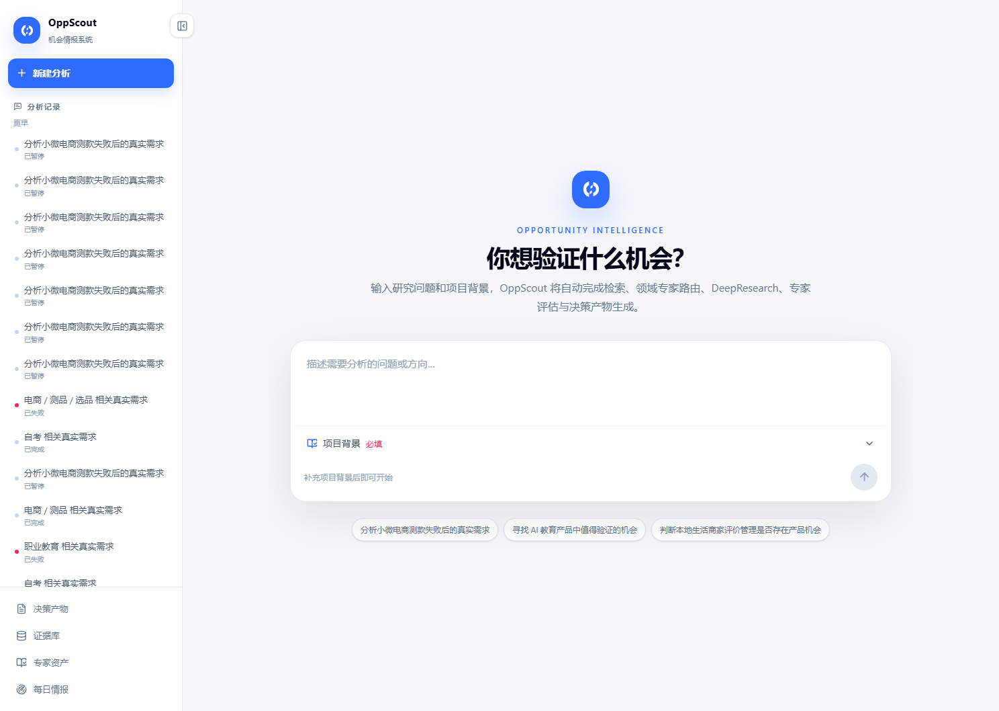
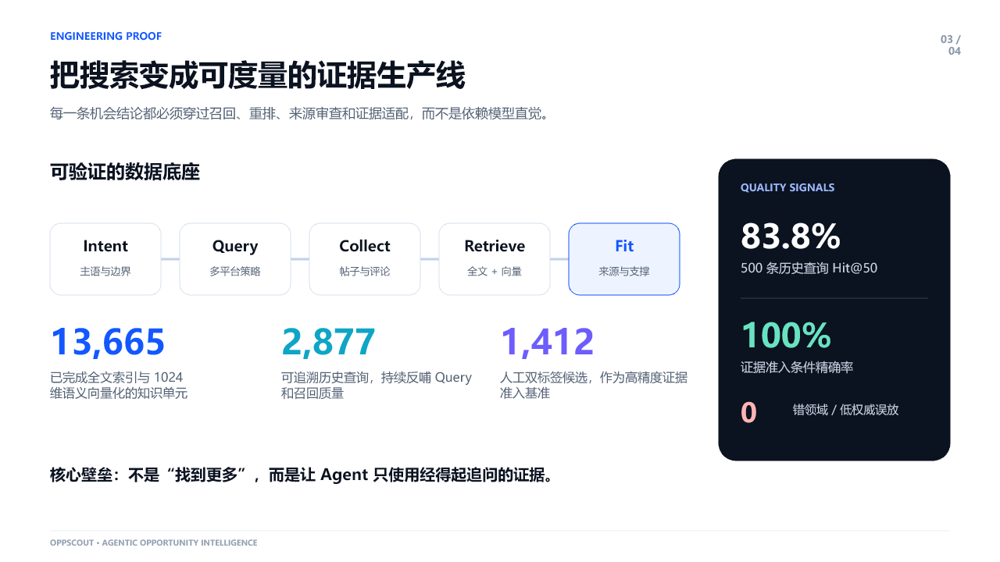
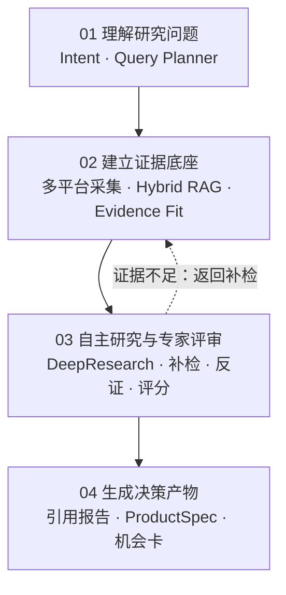
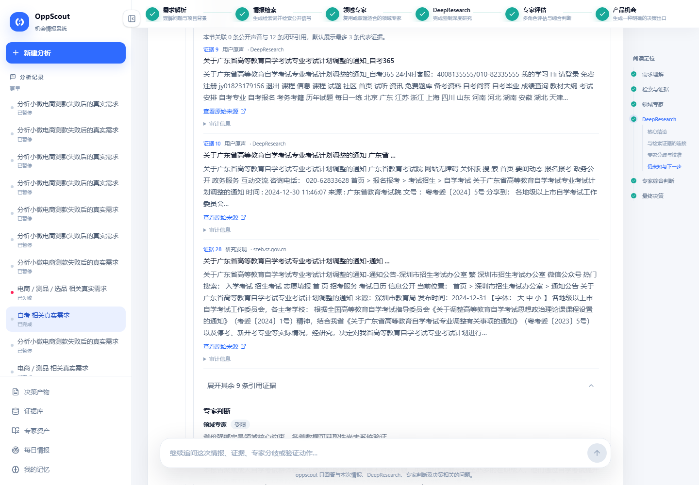
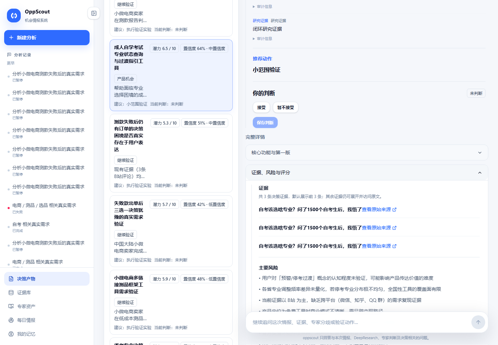

# OppScout

> Evidence-grounded product opportunity research system · 产品机会研究与证据化决策系统

[系统架构](docs/architecture.md) · [评测方法与结果](docs/evaluation.md)

OppScout 面向早期产品负责人、创业者、需求研究人员与 AI 产品团队，把一个研究方向转换为可追溯的研究任务、证据链、多角色评审和结构化决策产物。它不把普通搜索结果直接包装成结论，而是要求每个关键判断都能回到原始内容、来源链接或证据 ID。

这个仓库是面向招聘与技术交流的脱敏项目案例。生产源码、原始平台数据、Prompt、凭据和部署配置保持私有；这里公开系统设计、产品界面、评测口径和本人贡献。

## 一眼看懂项目

| 问题 | OppScout 的处理方式 |
| --- | --- |
| 用户只给出模糊方向 | Agent 识别研究主体、决策目标和产品边界，拆分查询族与证据通道 |
| 多平台信息分散、重复且噪声高 | 采集 B 站、抖音、微博、知乎和小红书的公开内容，规范化后写入 PostgreSQL 事实层 |
| 单路检索容易漏证据 | PostgreSQL FTS 与 BGE-M3/pgvector 并行召回，RRF 融合后由 BGE Reranker 重排 |
| 模型容易把相关内容当作可用证据 | deterministic evidence-fit 再检查主题、人群、场景、来源类型和权威性 |
| 一轮搜索无法闭合研究问题 | DeepResearch 执行 `plan → search → read → reflect → revise/write`，根据证据缺口补检 |
| 单个 Agent 容易确认偏误 | 需求、市场、供给、合规及领域专家进行补检、反证、分歧讨论和结构化评分 |
| 研究过程难复盘 | 保存任务状态、检索审计、证据引用、专家发言和最终决策产物 |

## 已验证结果

以下数字来自 2026-08-08 至 2026-08-15 的锁定评测和真实运行记录；完整统计边界见[评测说明](docs/evaluation.md)。

| 证据 | 结果 |
| --- | ---: |
| 500 条历史已知来源查询，生产等权 RRF Top-50 | **83.8% Hit@50** |
| RRF 相比 vector-only 的 query-macro known-source recall | **+2.28 个百分点**，95% CI `[0.98, 3.76]` |
| 36 条锁定查询、1,412 个双人标注候选 | Reranker Top-10 来源组覆盖 **94.33%** |
| deterministic evidence-fit | 条件精确率 **100%**；wrong-domain / authority-mismatch 误放均为 **0** |
| 最近一次完整候选成功链 | **28 分 30 秒**，22 次 LLM 调用，完成两轮 10 次专家发言并生成机会卡 |
| 最近一次完整仓库回归 | **1,197 passed / 17 skipped** |

这些结果刻意区分候选召回、来源组覆盖和证据准入：Reranker 负责排序，不拥有证据准入权；500-query known-source 评测也不把未观察到的结果当成负例。

## 端到端链路

| 阶段 | 核心组件 | 阶段输出 |
| --- | --- | --- |
| 01 理解问题 | Intent、Retrieval Planner | 研究边界、查询族与证据目标 |
| 02 证据生产 | 多平台采集、PostgreSQL、FTS/BGE-M3、RRF、Reranker、Evidence Fit | 可引用 Evidence Bundle 与检索审计 |
| 03 研究评审 | DeepResearch、领域专家、固定专家、两轮讨论 | 带引用研究结论、风险、反证与评分 |
| 04 决策输出 | ProductSpec、确定性质量门、Artifact Generator | 产品机会、继续验证或不建议推进 |

详细状态机、Agent 边界和失败恢复策略见[系统架构](docs/architecture.md)。

## 产品界面

研究过程被投影为连续文档，而不是多张互相割裂的 Agent 消息卡。用户可以查看 DeepResearch 正文、原始来源、证据引用、专家分歧和最终决策，并在同一研究上下文中继续追问。

最终结果分为产品机会、继续验证和不建议推进三类结构化产物，避免把证据不足的方向强行包装成产品机会。

## 我的贡献

OppScout 由我独立完成产品定义和核心系统实现，主要工作包括：

- **产品与架构**：定义从 public voice 到证据、研究、评审和决策产物的端到端合同，拆分 API、Worker、事实层和前端职责。
- **数据采集**：封装多平台采集与标准化管线，处理查询预算、去重、评论分页、浏览器会话和可追溯数据日志。
- **Agent Runtime**：实现 AutomationRun 状态机、候选任务编排、阶段预算、超时取消、失败重试、暂停恢复和过程事件流。
- **Agentic RAG**：实现 FTS/向量并行召回、RRF、BGE Reranker、来源组去重、evidence-fit 和离线评测闭环。
- **Agentic DeepResearch**：实现研究规划、网页安全读取、证据缺口反思、补充检索、引用闭合和带引用报告生成。
- **多 Agent 评审**：实现固定专家与动态领域专家的证据请求、两轮讨论、反证检查、分歧审阅和结构化评分。
- **后端与数据**：使用 FastAPI、PostgreSQL/pgvector、SSE/NDJSON 和独立 Worker 建设 API、事实源、任务状态与流式查询链路。
- **前端与部署**：实现 Next.js 研究工作台、证据回放和决策产物页面，并通过 Docker Compose、Nginx 与 GitHub Actions 完成发布和验收。
- **测试与评测**：建设检索锁定集、人工双标签评测、真实全链运行、回归测试与运行时性能归因。

## 技术栈

`Python` · `FastAPI` · `PostgreSQL 16` · `pgvector` · `BGE-M3` · `BGE Reranker` · `Next.js` · `Playwright` · `SSE / NDJSON` · `Docker Compose` · `Nginx` · `GitHub Actions`

## 公开边界

- 本仓库不包含生产源码、原始平台数据、Cookie、API Key、Prompt、数据库快照或部署地址。
- 图片中的内容用于说明产品交互和工程设计，不授权作为数据集或生产素材再分发。
- 如需了解实现细节，可从[系统架构](docs/architecture.md)和[评测说明](docs/evaluation.md)开始；面试中可进一步演示私有仓库中的代码与原始评测报告。
