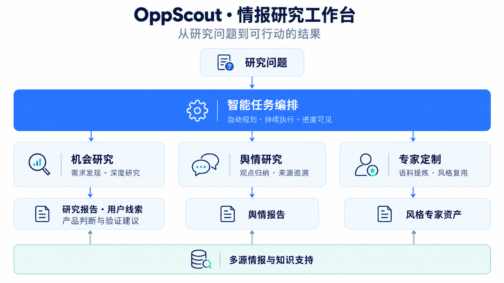

# OppScout · AI 商业情报研究工作台

**把一个研究方向，变成有依据的判断和可行动的方案。**

这是我独立设计与开发的多源商业情报与线索发现 Agent 系统。面向产品经理与创新业务团队，连接多源信息收集、深度研究、多角色审阅和需求用户线索，支持业务方向筛选、立项调研与用户验证。

[真实运行 SOP](docs/demo.md) · [功能成果](docs/results.md) · [系统架构](docs/architecture.md) · [作者主页](https://github.com/gaoming-a)

图中为一次真实研究交付的“测款盈亏决策计算器”产品方案。

## 项目实践成果

| 研究报告 | 用户线索 | 调研效率 |
| --- | --- | --- |
| **100 份**带引用研究报告 | **1,000+ 条**可追溯需求用户线索 | **4–8 小时 → 30 分钟内** |

以上为项目实践累计成果；下方通过单次真实任务展示功能和操作流程。

## 用户可以用它做什么

| 能力 | 使用方式 | 得到的结果 |
| --- | --- | --- |
| 需求与线索发现 | 输入业务方向，检索公开用户表达 | 需求线索、来源证据与潜在用户 |
| 机会研究 | 输入想验证的方向与背景 | 有来源的研究结果、产品方案和验证建议 |
| 舆情研究 | 提交关注的主题 | 主要观点、态度分布、争议焦点与可回看的原始来源 |
| 专家定制 | 提供代表性资料与语料 | 可审核、可复用的专家资产 |
| 研究追问 | 围绕当前结果继续提问 | 在同一研究上下文中进一步理解结论 |

## 一条真实任务，如何交付结果

**案例：小微电商卖家的测款复盘与投流成本判断。**

产品团队想知道：商家测款失败后遇到什么困难，已有工具解决到什么程度，是否值得做一款轻量复盘产品。

| SOP | 系统完成的工作 | 用户看到什么 |
| --- | --- | --- |
| 01 · 明确方向 | 理解研究问题、目标用户与场景 | 本次研究重点 |
| 02 · 收集信息 | 自动检索公开内容、整理来源 | 进度、来源与需求线索 |
| 03 · 深度研判 | 阅读资料并组织多角色讨论 | 研究结论、分歧与风险 |
| 04 · 输出方案 | 形成产品描述和后续验证动作 | 可继续推进的方案与行动建议 |

**[查看这条任务的完整操作与截图 →](docs/demo.md)**

本次研究形成了“测款盈亏决策计算器”的候选方案，说明目标用户、触发场景、预期输入与输出，并建议先做**小范围验证**。用户继续追问后，工作台给出了访谈对象、成本数据核验和继续推进条件。

## 从研究到日常使用

机会研究、舆情研究和专家定制共用同一个对话入口。已审核的专家可以通过 `@` 直接调用，研究和对话结果也可以继续追问。

舆情研究也已跑通真实案例：围绕“AI 生成代码为什么仍需要人工审查”，工作台将公开讨论整理为主要观点、主题和争议焦点，点击引用即可回看原始评论。

## 功能特点

- **研究自动推进**：把检索、分析、讨论和输出连接成连续任务，过程始终可见。
- **研究与线索连接**：从帖子、评论与回复发现潜在需求用户，将需求匹配与来源证据放在一起。
- **研究依据可回看**：来源、研究记录和结果放在同一条任务中，方便核查与追问。
- **判断来自多个视角**：需求、市场、供给、合规角色共同参与，展示观点与讨论结果。
- **成果可以接着用**：不仅给出结论，还整理方案、风险和验证动作，帮助推进后续工作。

## 系统如何协同

统一编排连接机会研究、舆情研究与专家定制，资料检索和知识支持服务于最终成果。

## 我的贡献

- **产品设计**：定义研究场景、用户操作流程和结果呈现方式。
- **Agent 实现**：设计自动规划、检索、阅读、分析与报告生成流程，连接需求、市场、供给和合规四类审阅角色。
- **多源情报与检索**：实现帖子、评论及回复的采集、清洗与存储，将混合检索、来源关联和用户线索接入研究任务。
- **完整系统开发**：实现后端与研究工作台，让用户持续查看过程、追问结论和回看历史成果。
- **功能交付**：打通真实任务运行、界面展示与结果回溯，持续扩展新的研究能力。

**技术关键词：** Agent · RAG · DeepResearch · 多角色协同 · Python · Next.js · PostgreSQL · Docker

---

高明 · Ming Gao｜Agent 开发 / 大模型应用开发｜[GitHub](https://github.com/gaoming-a)｜[1600064289@qq.com](mailto:1600064289@qq.com)

源码保持私有。界面截图于 2026 年 10 月 13 日在本地最新版实际操作采集，架构图为功能示意。
