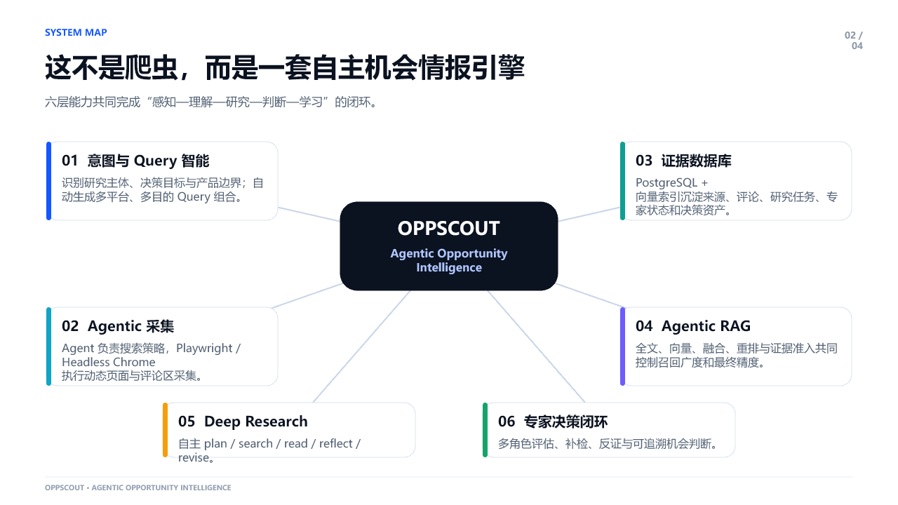
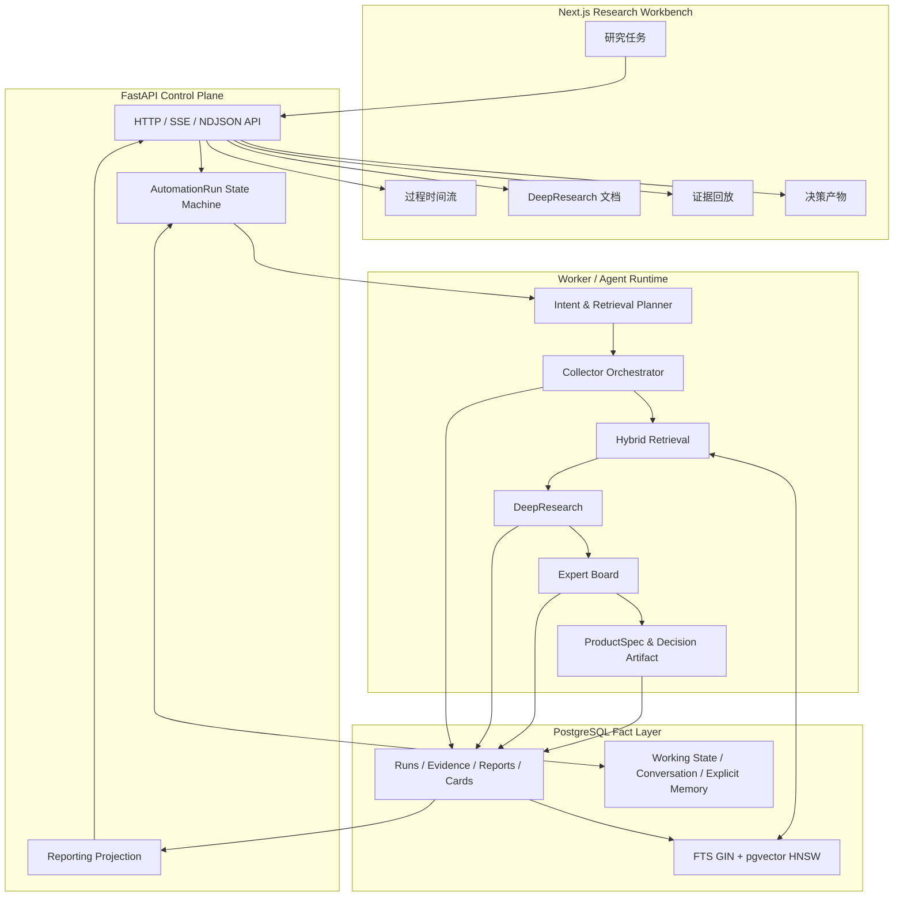
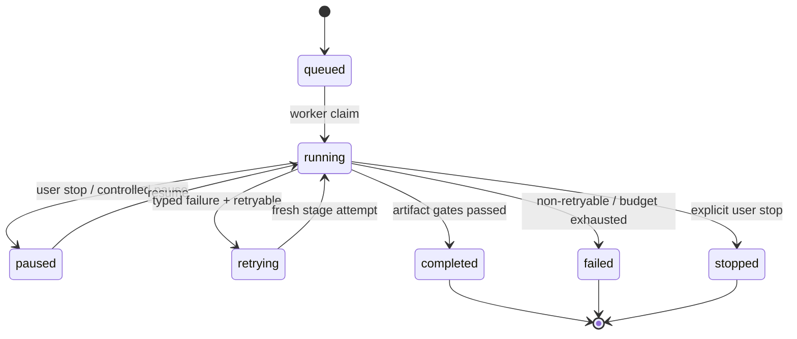

# OppScout 系统架构

## 设计目标

OppScout 解决的不是“把搜索结果总结一下”，而是把早期方向研究组织成一条可恢复、可评测、可审计的 Agent 工作流。系统设计围绕四个约束展开：

1. **事实和推断分离**：平台内容、网页快照和数据库记录构成事实层；Agent 只能引用事实层中存在的证据。
2. **排序和准入分离**：RRF 与 Reranker 优化候选排序，deterministic evidence-fit 决定哪些证据可以进入研究和评分。
3. **研究和决策分离**：DeepResearch 负责闭合研究问题，专家评审与确定性规则负责评分和产物类型。
4. **过程和终态同时可追溯**：运行事件、查询、来源、证据、专家发言和最终产物都绑定稳定 ID。

## 逻辑架构

## 运行状态与恢复

`AutomationRun` 是控制面的权威状态。API 只接收命令和投影状态，独立 Worker 领取任务并持有执行所有权。任务领取使用 lease、version 和 fencing token，避免多个 Worker 同时提交同一个阶段的结果。

关键实现边界：

- 每个阶段在写入证据、报告、评分和产品卡前检查 deadline/cancel。
- 失败被记录为 typed semantic/runtime failure，不用看似合理的文本静默替代失败结果。
- DeepResearch 重试重新执行当前研究阶段，不把旧结果伪装成本轮证据。
- 完成态结果写入 PostgreSQL，API/Worker 重启不会复制产品卡或回退 state version。
- SSE/NDJSON 只负责增量展示；只有持久化终态才被视为成功。

## Agentic RAG

线上检索链路固定为：

1. PostgreSQL 中文 FTS 与 BGE-M3/pgvector HNSW 使用独立连接并行召回。
2. rank-only RRF 合并两路名次，按 canonical source group 组织 Top-50。
3. `BAAI/bge-reranker-v2-m3` 对 Top-50 重排并输出 Top-10。
4. deterministic evidence-fit 检查来源类型、主题、人群、场景、权威性和领域锚点。
5. 未通过 fit 的候选保留审计原因，但不能进入后续证据包。

这样可以明确回答三个不同问题：是否召回了候选、是否把候选排到前面、候选是否有资格支撑结论。

## DeepResearch 与专家评审

DeepResearch 以 evidence request 为输入，执行计划、搜索、安全读取、发现抽取、覆盖反思和补检。网页搜索 snippet 只表示 `discovered`；只有正文读取成功、形成快照和 citation 后才能进入核心证据。

研究完成后：

- 固定需求、市场、供给、合规专家各自对自己的维度负责。
- 每个候选还绑定一名经过评测和审核的领域专家；没有可复用专家时先执行专家蒸馏与质量门。
- 专家基于同一个正式 ProductSpec 和闭合证据进行两轮讨论，输出 claim、反证、风险和结构化评分。
- 机会潜力、证据置信度和产物类型经过确定性门禁，最终输出产品机会、继续验证或不建议推进之一。

## 工程化边界

- API、Worker、PostgreSQL、BGE 服务和 Web 在 Compose 中独立运行。
- 只有 Nginx 暴露 80/443；数据库、检索服务和 Worker 保持内部可见。
- 浏览器采集运行在容器/服务器，Cookie 与运行时浏览器目录不进入 Git。
- GitHub Actions 执行构建、迁移、备份恢复检查、健康检查和发布后验证。
- 测试覆盖状态机、检索、证据拟合、引用闭合、专家合同、决策产物、PostgreSQL 集成和浏览器关键链路。
