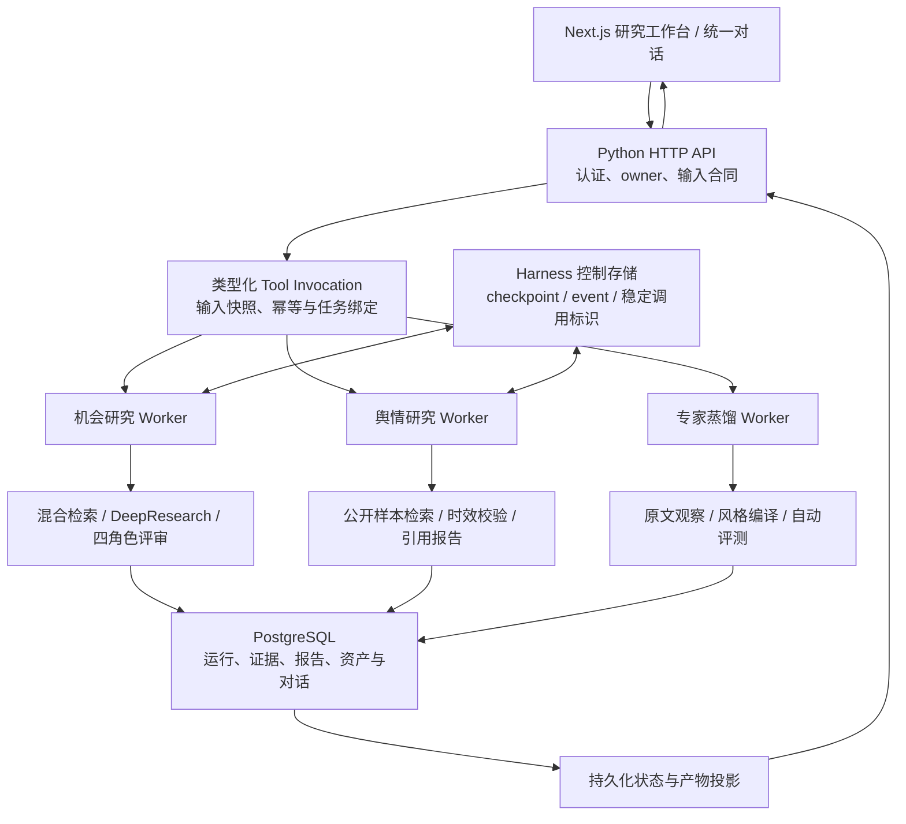
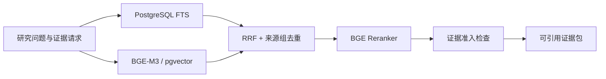

# 系统架构与实现边界

[项目首页](../README.md) · [文档索引](README.md) · [工程案例](engineering-notes.md)

核对日期：2026-10-13。以下描述当前开发版本的逻辑架构；已部署的历史版本与本地开发验收分别记录。

## 系统如何运行

后端当前使用 Python 标准库 HTTP Server 和自研请求处理器。API 接收指令、检查身份与输入、读取持久化投影；独立 Worker 负责长任务。网页连接负责展示进度，任务执行不依赖用户持续打开页面。

Harness 不替代机会研究、舆情研究与专家资产各自的业务状态。当前控制事实已接入机会检索、候选分析和舆情执行的部分恢复边界；专家蒸馏继续使用自身的冻结执行合同与恢复规则。

## Runtime：谁执行，何时可以继续

| 边界 | 当前处理 |
| --- | --- |
| 执行所有权 | Worker 使用持久化租约和 fencing token；结果写入前检查 owner、当前租约和有效期 |
| 任务重入 | 工具请求固定输入、版本与幂等标识，避免同一请求再次创建不同业务任务 |
| 阶段恢复 | 部分阶段记录 checkpoint / event 和稳定外部调用标识；只有确认的完成事实可以复用 |
| 外部调用结果未知 | 保存未知状态并停止自动重放，不能把请求超时当成“没有执行” |
| 并发与超时 | 普通模型与流式调用受进程内在途门限制；超时候选在原执行真正结束前仍占容量 |
| 预算与取消 | 现有业务服务分别执行时间、查询和 token 约束；同会话只允许一个活动回复流 |

在已实现的 PostgreSQL 切片中，业务状态与成对控制事实受同一个事务和租约检查保护。租约使用数据库时钟，并在等待行锁后再次检查有效期，避免等待期间过期的 Worker 获得写入权。

进程内模型并发门不等于平台全局配额；部分阶段恢复也不等于所有模型与外部工具调用都能安全重试。

## Tool 与 Skill：扩展能力的合同

- **Tool** 描述一项可执行能力的类型、必要输入、任务类型和产物入口。
- **Skill** 描述版本化目标、输入输出合同、允许能力和停止条件；执行快照固定内容指纹。
- **业务 Run** 保存各类研究的正式进度、结果和质量门。
- **Harness 控制事实** 保存调用、attempt、checkpoint 和 event 的身份及关系。

统一对话已经可以创建类型化机会研究、舆情研究和专家蒸馏任务。各工具的完整创建、停止、恢复接口尚未全部收敛到统一 Adapter。

## RAG：召回、排序、准入

FTS 与向量召回使用独立数据库连接并行执行。RRF 合并名次，Reranker 改善候选排序，证据准入另行检查主题、人群、场景、来源类型和权威性。同一原始文章或视频的多个片段归入同一来源组。

排序靠前不代表有资格支撑结论。网页搜索摘要仅用于发现来源；正文读取、证据绑定与引用检查负责研究中实际使用的资料。具体指标见[评测说明](evaluation.md)。

## 三种业务路径

### 机会研究

研究方向 → 意图与检索计划 → 公开信号与候选 → 项目领域校准 → Claim–Evidence 矩阵 → DeepResearch → 正式产品规格 → 需求 / 市场 / 供给 / 合规评审 → 决策产物。

当前在线主流程使用项目校准与固定四角色评审。定制专家的离线蒸馏和审核不再作为每个候选都必须等待的前置步骤。

结论分为产品机会、继续验证和不建议推进；缺少证据会保留为待验证项，不自动解释成反证。

### 舆情研究

从 owner 所属对话的类型化工具调用创建，冻结检索时效窗口，按公开样本形成报告。报告结论与主题绑定实际证据 ID，保留样本数量、时间及来源范围。

这条路径不进行产品机会评分，检索到的样本也不能直接代表全网总体。

### 风格专家

原文与 URL → 来源读取与观察 → 表达 / 互动覆盖检查 → 程序编译风格规则 → 基线 / 加载后三轮对话评测 → 私有待审核资产。

语料原文和证据保留用于审计；直接对话使用可迁移的风格规则。领域知识通过单独范围授权和知识检索提供，风格规则不能添加事实、改写用户题设或扩大工具权限。无证据的价值观、判断及情绪规则不会被补成“完整人格”。

## 多用户与交互

- 已实现邮箱注册、登录、退出、会话续期、邮箱验证和密码找回；未验证账号只允许认证操作。
- 首次注册支持当前设备匿名历史归属迁移，业务数据按 owner 校验，列表查询先隔离再分页。
- 系统维护任务与普通用户任务使用不同身份边界。
- 登录状态切换中止旧流并清理旧身份缓存；SSE / NDJSON 提供真实增量，持久化完成态才是正式结果。

这些改动有本地与数据库合同验证，不据此宣称最新开发版本已经完成公网多用户发布或容量验收。

## 当前完成范围与下一阶段

| 已落地 | 尚待完成 |
| --- | --- |
| 统一能力描述、Skill 快照、类型化调用 | 完整 Tool Adapter 生命周期 |
| 通用 checkpoint / event 控制存储 | 所有业务阶段及外部调用的恢复与对账 |
| PostgreSQL 舆情与机会研究部分原子恢复切片 | Harness 统一预算与跨进程配额 |
| 各业务正式产物与证据追溯 | 统一 Artifact Graph 与扩展治理 |
| 本地回归、隔离数据库和指定真实模型验收 | 最新版本完整 CI、人工审核与相应部署验收 |

后续沿现有合同推进，逐阶段验证；本展示不会把路线图描述为已实现功能。
