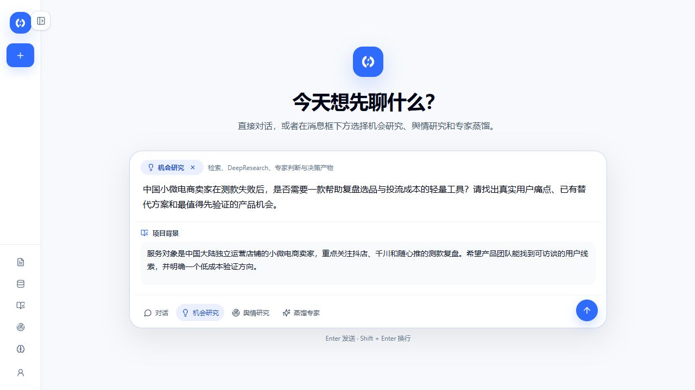
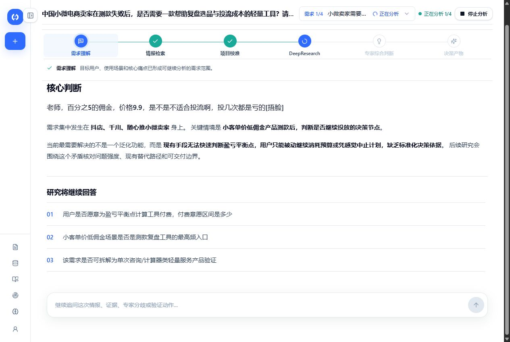
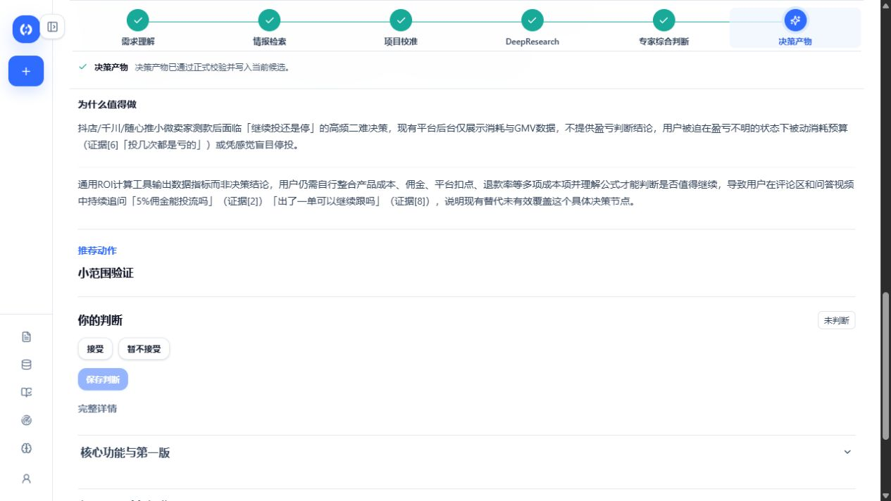
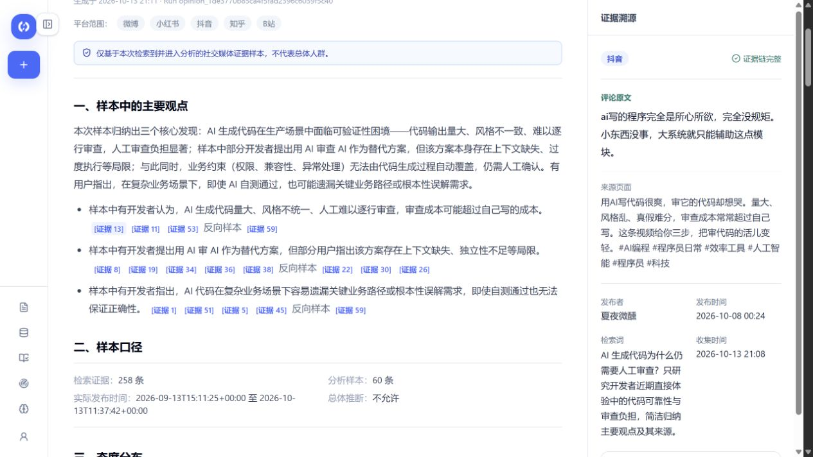

# 真实运行 SOP：从研究问题到验证方案

[项目首页](../README.md) · [功能成果](results.md) · [系统架构](architecture.md)

**案例：小微电商卖家的测款复盘与投流成本判断。**

产品团队想验证：商家测款失败后是否需要一款轻量复盘工具。下面沿真实页面查看问题输入、来源收集、需求提炼和最终交付。

## 01 · 提出研究方向

用户在工作台提供研究方向与背景，系统梳理目标用户、使用场景和需要回答的问题。

本例关注中国大陆独立运营店铺的小微卖家，重点是抖店、千川和随心推的测款复盘，希望找到可访谈线索与低成本验证方向。

**这一步得到：** 后续研究围绕什么问题展开，以及需要哪些资料支持判断。

## 02 · 自动收集信息

系统检索公开内容，将来源与需求线索整理到研究现场。进度、帖子与评论变化、最新来源和原网页入口同时可见。

**这一步得到：** 可以回看出处的材料，以及需要进一步研究的用户问题。

## 03 · 从用户表达中提炼需求

系统识别出一个具体问题：低客单价、低佣金产品测款之后，小微卖家难以判断是否应继续投流，缺少清晰的盈亏判断依据。

**这一步得到：** 一个可继续研究的具体需求，以及付费意愿、使用频率和轻量验证方式等后续问题。

## 04 · 继续查证与综合研判

深度研究继续查找公开网页，核对现有工具、付费依据和平台边界，保留来源取舍记录。需求、市场、供给与合规角色共同参与后续判断。

**这一步得到：** 对产品价值、落地条件与待验证问题的综合判断，并能回看不同角色的发言和引用来源。

## 05 · 输出方案与下一步行动

本例形成“测款盈亏决策计算器”的候选产品方案，整理目标用户、触发场景、预期输入输出，并给出“小范围验证”的推荐动作。

**这一步得到：** 可以用于后续讨论和验证的结构化方案。

## 06 · 沿当前结果继续追问

继续提出“先找谁访谈、核验哪些成本数据、怎样判断值得继续”，工作台结合当前研究给出三步验证清单，并区分已知事实与待验证假设。

**这一步得到：** 可用于访谈和产品验证的行动材料。

## 本次演示交付了什么

**研究问题 → 来源资料 → 具体需求 → 综合判断 → 下一步行动。**

用户可以在同一工作台看到这条链路，并理解最终建议从哪里来。

## 专家如何在日常对话中使用

在消息框输入 `@`，选择已审核可复用的专家，即可直接提问。这里实际调用了“成人自考选专业专家”，获得信息核验步骤，并在同一对话中继续追问。

## 舆情研究：从公开讨论到有来源的报告

**案例：AI 生成代码为什么仍需要人工审查？**

1. 在对话入口选择舆情研究，输入关注主题和研究范围。本例关注开发者近期体验中的代码可靠性与审查负担。
2. 等待系统完成公开讨论采集与归纳，报告展示主要观点、态度分布、讨论主题和争议焦点。本次真实任务收集 258 条资料，选取 60 条进入分析。
3. 点击观点旁的证据编号，右侧显示对应评论、来源页面、发布时间和原网页入口，帮助理解结论的依据。

**这一步得到：** 一份可以阅读、导出并回溯来源的舆情报告。报告只描述本次取得的样本；[查看完整报告界面](results.md#公开讨论可以形成有依据的报告)。

界面截图于 2026 年 10 月 13 日在本地最新版实际操作采集。主案例展示一个已完成候选需求的完整链路；专家对话和舆情研究为独立案例。图中的计算器是 Agent 输出的候选产品方案。
