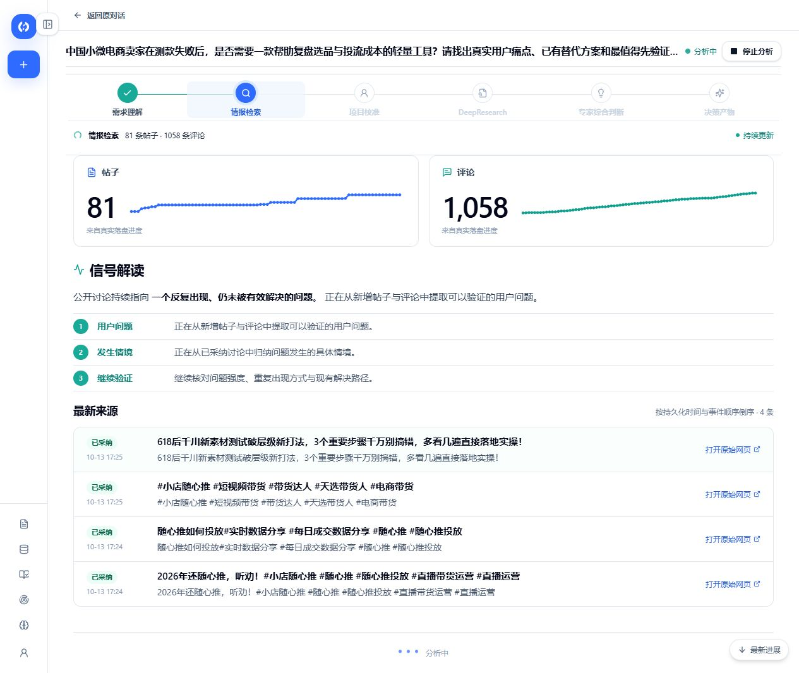
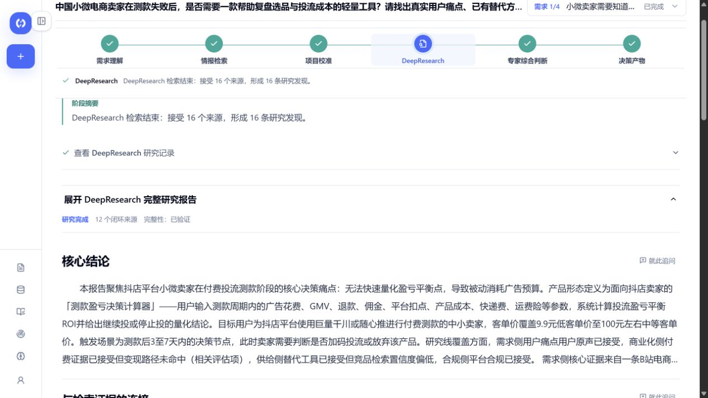
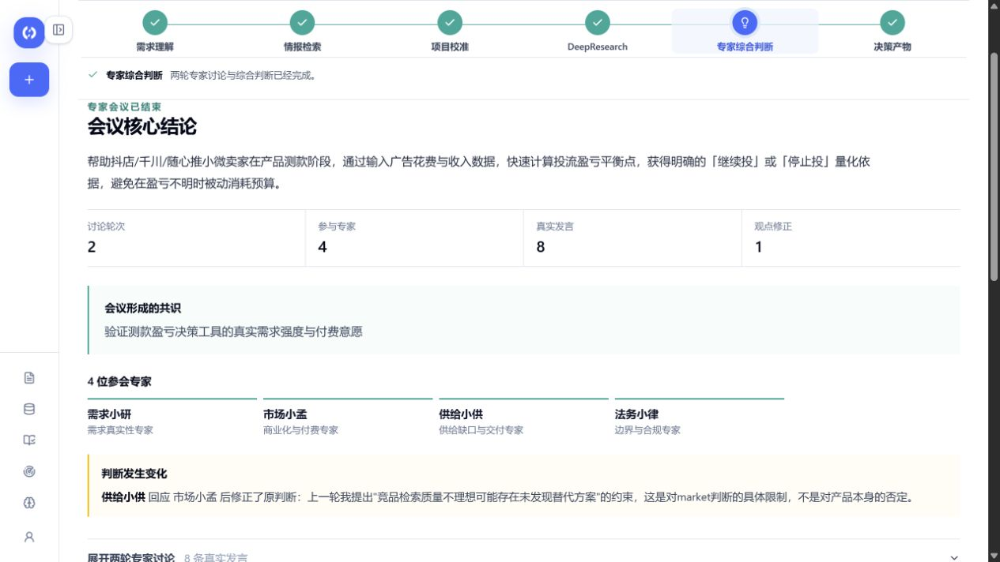
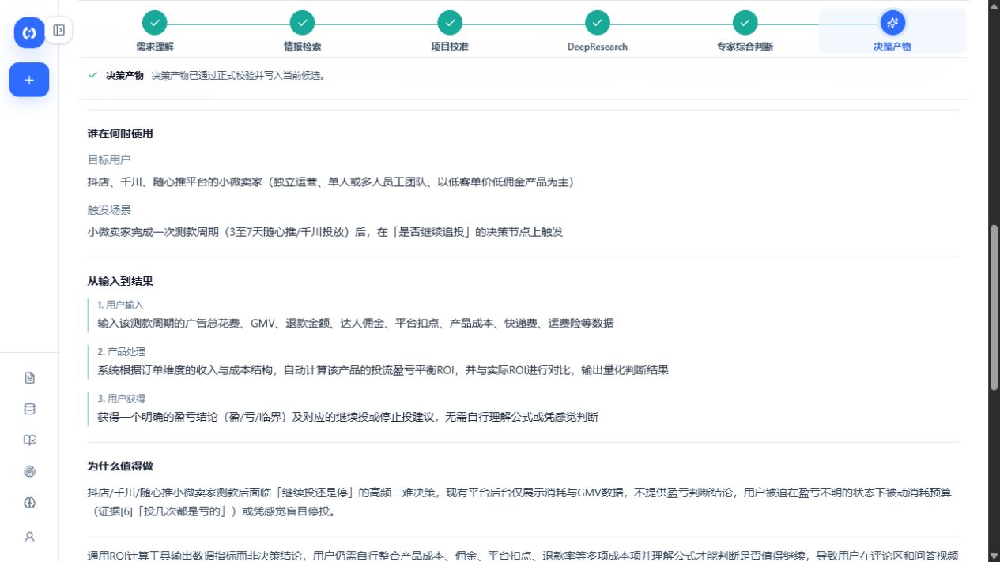
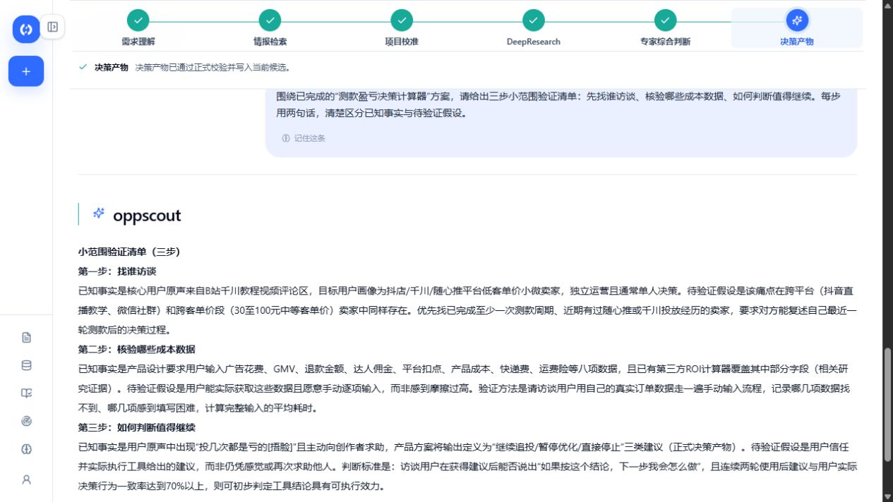
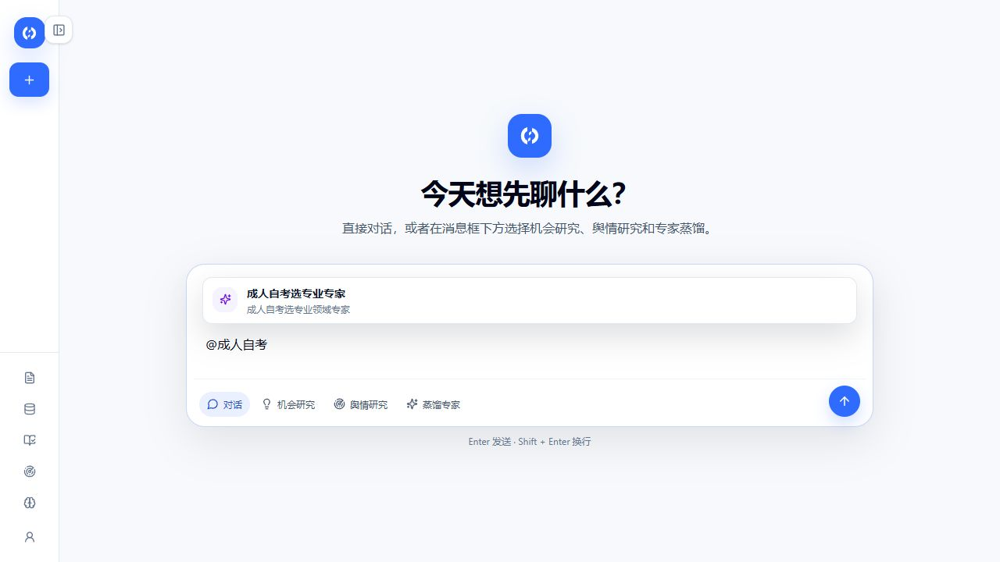
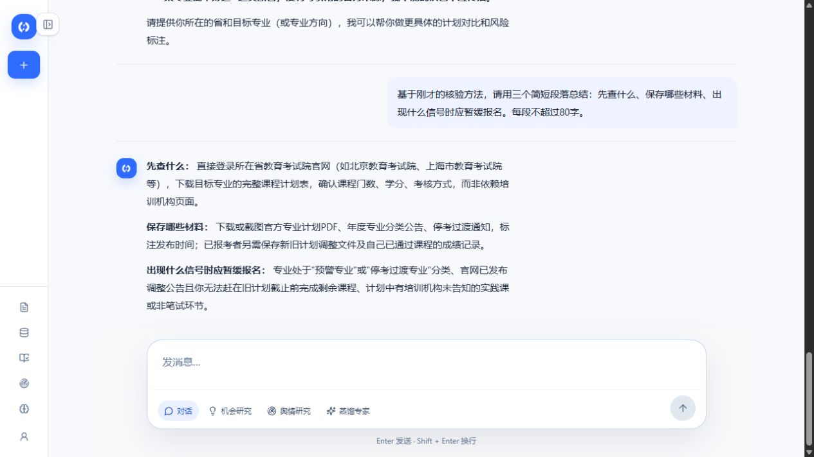
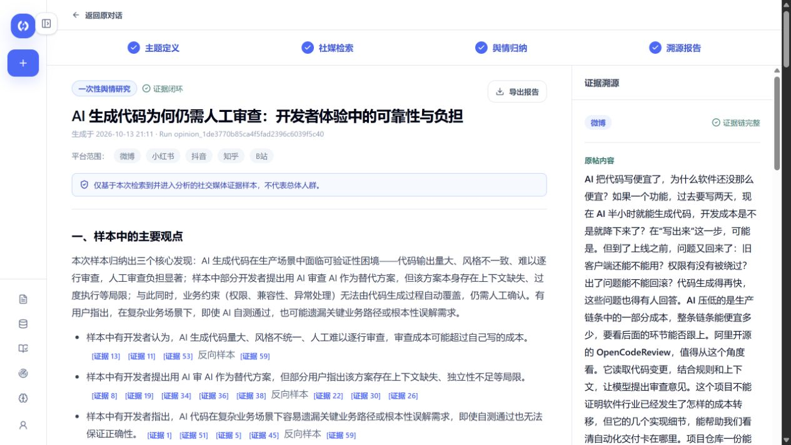

# 功能成果：用户最终得到什么

[项目首页](../README.md) · [真实运行 SOP](demo.md) · [系统架构](architecture.md)

OppScout 把分散的信息收集、资料阅读、观点讨论与结果整理，连接成一条可在工作台持续查看的研究任务。

## 信息收集有过程，也有出处

公开来源进入同一研究现场，用户可以看到进度、需求线索与原网页入口。

**功能价值：** 既能了解系统正在做什么，也能回到来源查看分析依据。

深度研究将资料整理成完整报告，用户可以从核心结论继续追问，也可以展开正文查看每个研究问题。

## 多个视角共同形成判断

需求、市场、供给与合规角色参与研究，工作台保留各自判断、来源依据与交叉回应。

**功能价值：** 把不同角色关注的问题放在一起，帮助用户理解建议和分歧。

## 结果可以接着推进

“测款盈亏决策计算器”候选方案明确目标用户、触发场景、预期输入输出和“小范围验证”的推荐行动。用户继续追问后，还获得了访谈对象、成本核验和继续推进条件。

**功能价值：** 将研究结论转化为后续讨论、产品设计与验证工作的材料。

## 向更多情报场景扩展

| 方向 | 功能特点 | 对应成果 |
| --- | --- | --- |
| 机会研究 | 从公开信息中研究需求和产品方向 | 研究报告、机会判断、验证方案 |
| 舆情研究 | 围绕主题采集讨论并归纳观点与分歧 | 舆情报告、态度分布与可回看的原始来源 |
| 专家定制 | 从资料和语料中提炼可复用能力与风格 | 专家资产 |

## 专家可以直接用于对话

已审核可复用的专家可通过 `@` 选择并调用；用户随后能在同一对话中继续理解回答。

## 公开讨论可以形成有依据的报告

在“AI 生成代码为什么仍需要人工审查”的实际任务中，系统收集公开讨论，归纳代码可靠性、审查负担与“AI 审 AI”的主要观点，展示态度分布和争议焦点。

**功能价值：** 快速了解样本在讨论什么，以及每个观点来自哪些评论；点击引用即可回看原文和来源页面。

界面图片采集自本地最新版的真实机会研究、舆情报告与专家对话；三类能力的协作关系见[架构图](architecture.md)。
